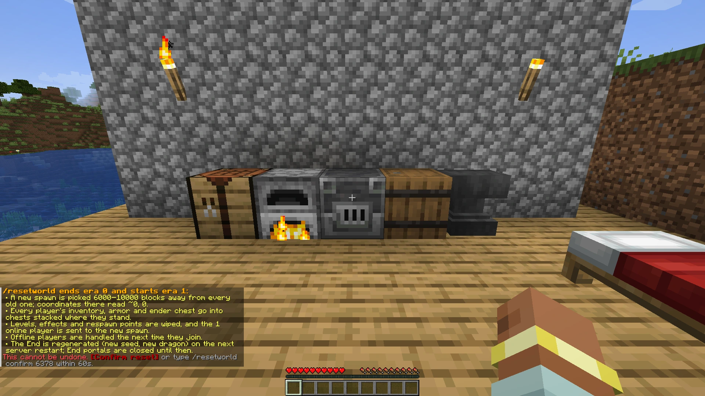
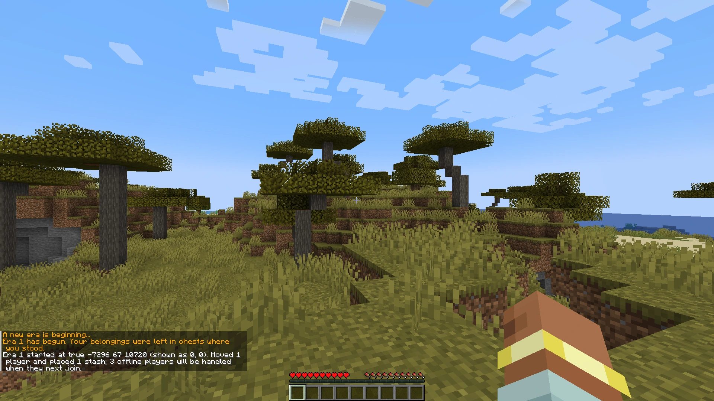
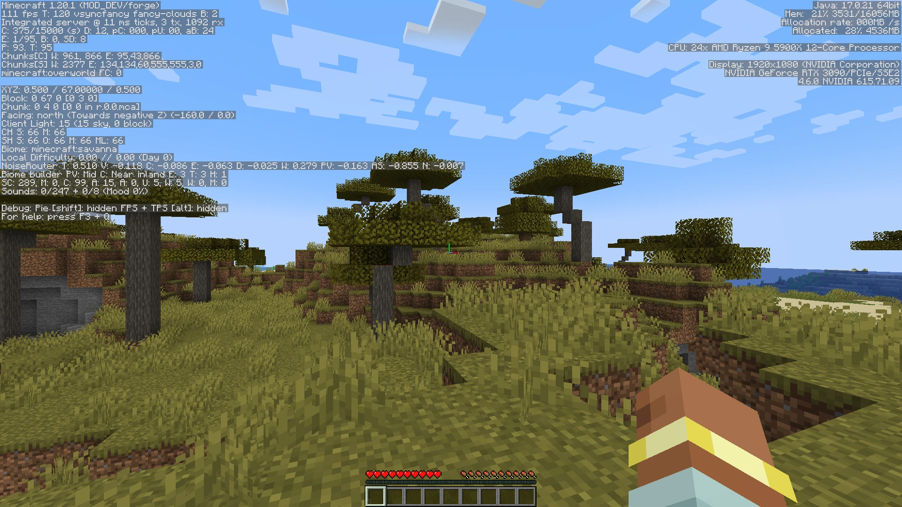
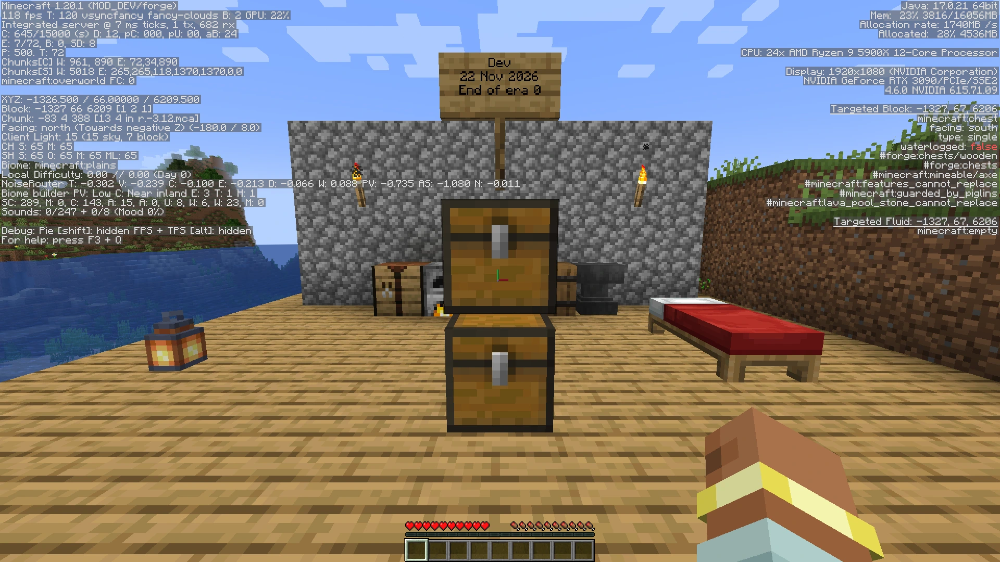
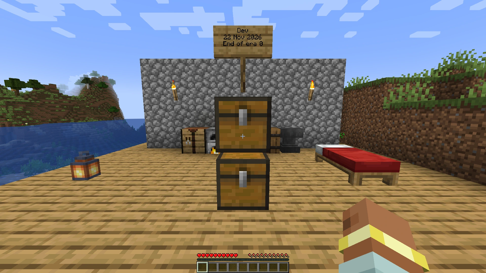
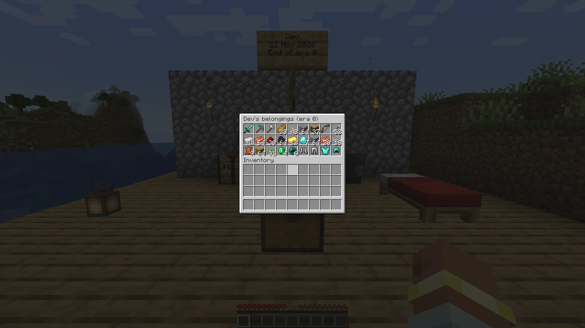
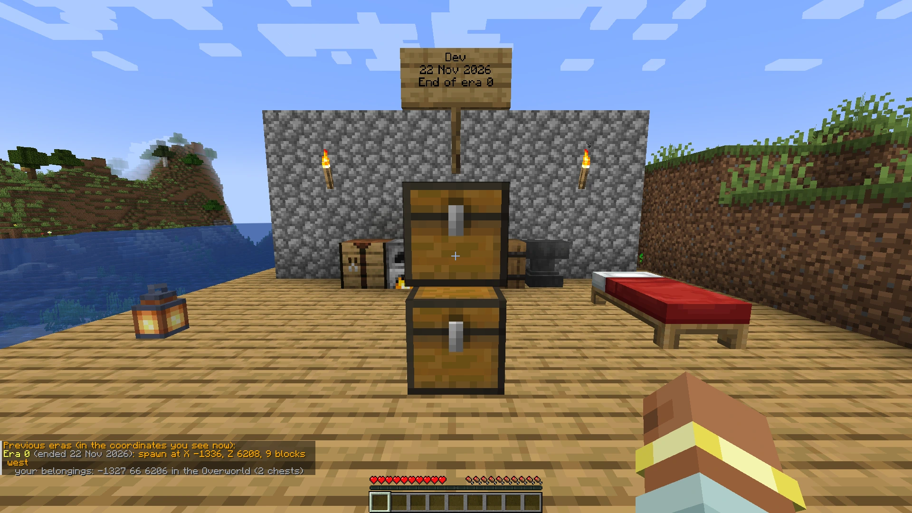

# Forevercraft

A Forge 1.20.1 mod for a long-running server that "resets" without ever deleting the world. Each reset starts a
new **era**: spawn moves thousands of blocks away, everyone starts with nothing, and the old bases are still out
there for players to find once they can make the trip.

Install the jar on the server **and** every client (it is in the modpack). Clients without it cannot join.

## Screenshots

| | |
| --- | --- |
|  |  |
| `/resetworld` explains what will happen and asks for a one-time code. | Everyone arrives at the new spawn with nothing. |
|  |  |
| The new spawn reads as 0, 0 on F3... | ...and the old base is now somewhere around X -1326, Z 6209. |
|  |  |
| What's left behind: the player's belongings, stacked where they stood, with a waxed sign. | Everything they carried, armor and ender chest included. |



`/previousbases` (ops only by default) lists old spawns in the coordinates players see now.

## Features

| Feature | What it does |
| --- | --- |
| 1:1 Nether | Nether portals map coordinates 1:1 instead of 1:8. Only the Nether's scale is changed, so modded dimensions keep theirs. |
| `/resetworld` | Starts a new era after a confirmation step. See below. |
| Hidden coordinates | F3 shows coordinates relative to the current era's spawn, so spawn reads ~0, 0. Applies to the Overworld and Nether. F3+C and F3+I (which copy true coordinates) are disabled while hidden. |
| `/previousbases` | Ops only by default: lists earlier eras' spawns in current coordinates, with distance and direction. Players are meant to find old remains themselves. |
| Elytra ban | Elytra flight is disabled by default (the server enforces it; the client shows a tooltip). |

## What `/resetworld` does

1. Shows a summary and a one-time code. `/resetworld confirm <code>` (or clicking **[Confirm reset]**) within 60 s runs it.
2. Picks a new spawn 6000–10000 blocks from the last one and at least 6000 from every earlier one, preferring
   spots within 20000 of 0,0 so strongholds stay in reach. It prefers land.
3. For every online player:
   - inventory, armor, offhand, crafting grid, cursor item and ender chest go into single chests stacked where they
     stand, named `<player>'s belongings (era N)`, with a waxed sign on top giving the player's name, the date and
     the era. The mod looks for free space nearby, avoids lava, and never overwrites another block entity;
   - levels, effects and respawn point are wiped, and health and hunger are refilled;
   - they are sent to the new spawn.
4. Players who were offline get the same treatment the next time they join, at the spot where they logged out.
5. The End is queued for regeneration. Travel to the End is blocked until the next server restart. On that
   restart the old `DIM1` folder is moved to `world/forevercraft/old_ends/`, the dragon fight is reset, and the End
   generates from a new seed with a new dragon.

Players in the End during a reset get their stash at the previous era's spawn, because the End is about to be
wiped.

## Commands

| Command | Permission | Notes |
| --- | --- | --- |
| `/resetworld` | 4 (configurable) | Preview plus confirmation code |
| `/resetworld confirm <code>` | 4 (configurable) | Runs the reset |
| `/previousbases` | 2 (configurable) | Old spawns in current coordinates, plus your own stashes |
| `/forevercraft status` | 2 | Era, true spawn, offset, End seed, offline players still to be reset |
| `/forevercraft stashes` | 2 | Every stash, in true and displayed coordinates |
| `/forevercraft truecoords` | 2 | Toggles true coordinates on your own F3 screen (command arguments always use true coordinates) |
| `/forevercraft recenter` | 2 | After a manual `/setworldspawn`, makes the new spawn read ~0, 0 |

## Config (`config/forevercraft-common.toml`)

| Key | Default |
| --- | --- |
| `nether.oneToOne` | `true` |
| `reset.permissionLevel` | `4` |
| `reset.minSpawnDistance` / `maxSpawnDistance` | `6000` / `10000` |
| `reset.preferredMaxRadius` | `20000` |
| `reset.enderChest` | `STASH` (`CLEAR`, `KEEP`) |
| `reset.resetEnd` / `blockEndUntilRestart` | `true` / `true` |
| `coordinates.hideTrueCoordinates` | `true` |
| `coordinates.dimensions` | `["minecraft:overworld", "minecraft:the_nether"]` |
| `elytra.disabled` | `true` |
| `previousBases.permissionLevel` | `2` |
| `previousBases.showOwnStashes` | `false` |

Edits are picked up live and pushed to connected clients.

## Limits worth knowing

- **Coordinate hiding is obscurity, not security.** The client is told the offset so it can shift F3. A modified
  client, or a minimap mod (Xaero's, JourneyMap) or Jade's optional coordinates line, would show true coordinates.
  Avoid adding minimap mods if hidden coordinates matter.
- **Commands use true coordinates.** Ops who type coordinates should use `/forevercraft truecoords` first.
- **Only vanilla inventories are stashed.** If you add a mod with extra equipment slots (Curios, Accessories),
  those items are not moved yet.
- **The End regenerates on restart, not immediately.** Single-player counts a world reload as a restart.
- **Create trains or contraptions in the old End** are left in the mod's saved data with nothing behind them once
  the End regenerates.
- **Terrain and dungeon mods are fine.** The mod does not touch Overworld or Nether generation. The End's new seed
  goes through `ServerLevel#getSeed`, which datapack and most modded End generators use.

## Building

```sh
./gradlew build            # build/libs/forevercraft-1.20.1-<version>.jar
./gradlew test             # unit tests (F3 rewriting, spawn planning)
./gradlew runGameTestServer  # in-game tests: online, offline and in-the-End resets
```

Requires JDK 17 (Gradle downloads one if needed).
